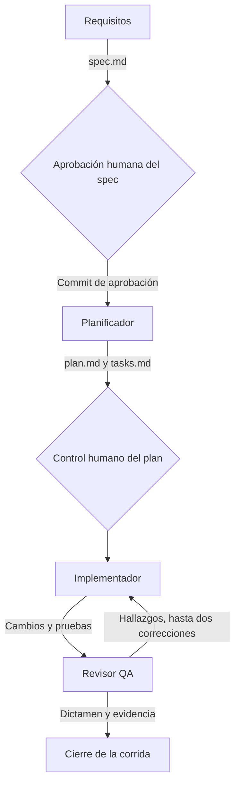

# Decisiones y coordinación · Entregable 4

## Alcance de trabajo

La alternativa A del plan simplificado usa MIRA CU-2 Soporte y operación. La funcionalidad propuesta evalúa si se puede autorizar el reprocesamiento de un caso y devuelve el resultado, su motivo y la acción sugerida. La entrada exacta de la corrida, sus reglas y excepciones se fijarán con el kit de CU-2 y las aclaraciones del representante del cliente.

## Patrón y traspasos

La coordinación propuesta es **secuencial con devolución de QA**. Las salidas de requisitos y planificación se revisan antes de autorizar el paso siguiente. Así cada agente puede trabajar sobre una versión identificada y las correcciones de QA llegan al Implementador junto con el hallazgo y su evidencia. El plan fija un máximo de dos correcciones después de la primera revisión. Si se agota el límite, se registra el bloqueo.

Se descarta la delegación dinámica a trabajadores para este flujo. La secuencia de responsabilidades ya está definida. Un agente dedicado a decidir quién actúa consumiría uno de los cuatro roles, agregaría intercambios y haría más difícil comprobar en qué momento se leyó cada aprobación.

| Rol | Entrada | Salida prevista |
| --- | --- | --- |
| Requisitos | Necesidad, kit de CU-2 y aclaraciones del representante. | `spec.md` con historia, criterios de aceptación y caso de uso. |
| Planificador | Especificación aprobada y referencia al commit humano. | `plan.md` y `tasks.md` con actividades y cobertura por criterio. |
| Implementador | Plan revisado, tareas y, si corresponde, hallazgos de QA. | Código, tests, `implementacion.md` y salida real de las pruebas. |
| Revisor QA | Especificación, cambios y resultados de pruebas. | Dictamen con hallazgos y veredicto. La persona operadora lo conserva en `revision.md`. |

## Herramientas y permisos previstos

El plan de CU-2 propone Antigravity con Orchestrator Neon. Quedan por registrar la versión, los modelos, la ubicación efectiva de las definiciones y la verificación de los permisos. Requisitos y Planificador requieren escritura para producir sus documentos. Implementador requiere escritura para el código y las pruebas, además de ejecución local para generar la salida de `pytest`. Revisor QA requiere lectura de la especificación, los cambios y los resultados. Estas son responsabilidades previstas por rol y su configuración efectiva se documentará con la evidencia de la herramienta.

## Control de commits y etiqueta

- Registrar el hash del punto de partida común una vez que se fije la versión inicial de ambas corridas. `c6d40b0` es el commit inicial observado en este repositorio. La base de la comparación se fijará cuando estén preparados sus insumos.
- Versionar la preparación, los artefactos del flujo, la implementación y la evidencia en commits identificables. Se usarán mensajes como `docs: organiza el repositorio de CU-2` y `docs: registra el traspaso de Requisitos a Planificador`.
- La persona que apruebe la especificación registra su nombre, fecha, decisión y revisión exacta del archivo en **un commit humano propio y anterior al código**. Vincular ese hash desde la bitácora. Registrar también quién revisó el plan, qué revisó y qué decidió.
- Vincular cada entrega o corrección con el hash del cambio y la evidencia correspondiente. Antes del cierre, comprobar que los enlaces abren desde el repositorio y que el README permite lanzar la demostración desde la versión a entregar.
- La pauta nombra `entrega-3` para la demostración y entrega. El plan de CU-2 indica confirmar el nombre con el docente. Crear una etiqueta anotada en el commit final validado una vez confirmado el nombre, verificar su destino en GitHub y comprobar el acceso del docente. Si ese nombre ya identifica otra versión, resolver la colisión con el docente antes de cualquier cambio.

## Referencias

- *Plan simplificado del Entregable 4 · MIRA CU-2*, secciones 1, 3, 4, 7–9.
- *Entregable 4 · Sistemas multiagente, caso MIRA*, pp. 4–5, 7–8, 10 y 12.
